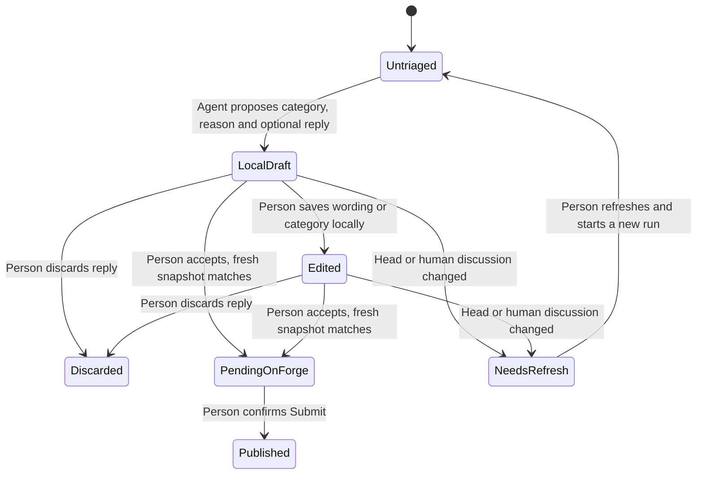

# Author thread triage interactions

The first author-side slice implements D13: help the person work through review
threads on their own change. It uses the existing read-only agent driver and
local drafts channel. Code editing remains the editor's separate job (D17).

## Entry and layout

An inbox row opens the existing change workspace. When the configured account
is the author, **Threads** is the initial tab; **Overview**, **Changes** and
**Review** remain available. Other people's changes keep the existing default.

The Threads view puts these interaction points in one place:

| Point | Person's action | Visible result |
|---|---|---|
| Start | Select an available agent and click **Triage open threads** | A pinned run starts; progress and **Talk to the agent** are available. |
| Scan | Jump to **Must fix**, **Discuss**, **Nit**, or **Untriaged** | Category counts and complete discussions, with the rationale immediately above each thread. |
| Inspect | Read the agent's reason and original notes; click **Open in Changes** for an anchored thread | The existing diff workspace opens at the file. |
| Edit | Click **Edit reply and category**, change the wording/category, then **Save locally** | The reply remains local, is marked edited by you, and the agent cannot overwrite it. |
| Accept | Click **Add to pending replies** | A fresh forge read checks the change/head/thread; a private pending reply is created on the original thread. |
| Publish | Use **Submit** in the existing change header | The existing confirmation says what others will see; explicit submission publishes the pending comments. |
| Set aside | Click **Discard reply** | The reply stays in the run as discarded; the category and reason remain visible. |
| Read-only forge | Edit or **Copy reply** | Local triage still works. Forgejo exposes no posting action until its write adapter lands. |

A category is an agent suggestion, not a verdict. **Must fix** is supported
correctness or security work; **Discuss** covers questions, tradeoffs and
uncertainty; **Nit** is a minor optional improvement. The person can move a
thread by editing its category. An empty reply is valid: classification does
not oblige the agent to invent an answer or a claim that code was fixed.

## Reply lifecycle

Accepting creates a private forge draft, so the label says **Add to pending
replies**, rather than implying that it publishes. The reply body contains only
the proposed/person-edited reply. The category, rationale and agent attribution
remain in Vuoro's local record and are never silently added to the comment.
Published state is read from the forge; the run records that a reply was accepted,
not that it was published. Deleting a forge draft does not delete run history.

## Partial results and changes while working

All unresolved discussions containing human review input are shown, including
general discussions. Bot/system-only, resolved and author-only threads are
excluded. Agent output appears as it arrives; incomplete or failed work leaves
threads in **Untriaged**, never implicitly classified or resolved.

Each run captures the complete human discussion and the current head. A new,
edited or removed human note invalidates that thread's prepared reply even if
it has no timestamp. Bot/system activity alone does not invalidate a reply.
The UI warns from its cached snapshot; acceptance checks again after a fresh
forge read. A resolved/closed thread, moved head or wrong change is refused.
**Refresh** reads current forge state; **Run triage again** starts a new explicit
run. Local edited text and older runs stay available for copying; no automatic
rerun spends agent quota.

The conversation provides questions, redirection and **Stop**. Leaving Threads
stops its UI polling, while the deliberately started agent run follows the
existing run lifecycle and remains resumable. Missing tools disable starting
triage and leave manual thread reading/replying available. Read failures show an
error and retain previously loaded drafts. Polling and local actions are ordered
so a previous poll cannot overwrite a newer edit response.

## First-slice scope and follow-ups

This slice groups threads and drafts replies; it does not resolve them, change
code, create an approval or infer a posted state. There is one triage session,
with the same proven driver lockdown as a reviewer. No synthesizer/verifier is
used because these are existing discussion suggestions, not new review findings
that D31's pipeline verifies.

Possible later interaction refinements, not automatic additions to this ticket:

- Focus **Open in Changes** on the exact thread rather than its file.
- A persistent split view for conversation and discussion.
- Select particular threads before triage when a change has many discussions.
- Offer an explicit comparison between an older reply and a changed thread.

Nonempty live GitLab and posting validation remain the separate live gate;
fixtures exercise these interactions without real forge writes or agent quota.
